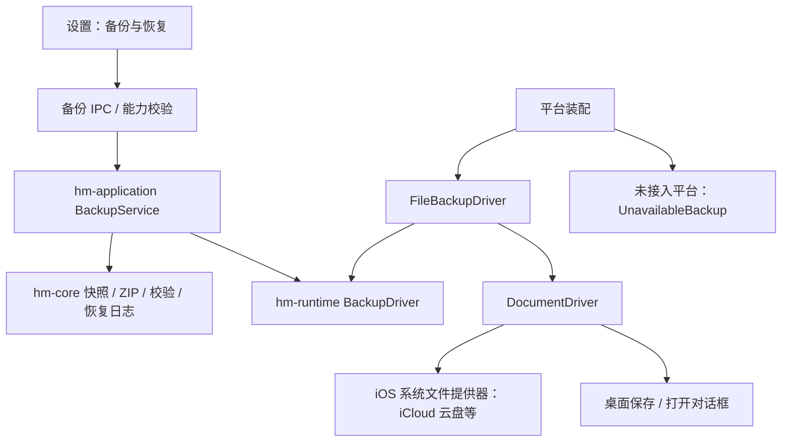

# 备份子系统

备份规则不依赖操作系统、文件提供器或云服务。界面只使用类型化备份命令；后端统一生成一致快照、校验和恢复，通过可替换驱动传输文件。

## 职责与调用

- `crates/hm-core/src/backup.rs`：SQLite 在线快照、材料 SHA-256 清单、完整性/外键/版本/材料引用校验、恢复前副本、恢复日志和失败回滚。
- `crates/hm-core/src/backup/archive.rs`：将已验证快照流式打包为 ZIP；从流读取、限量解包、拒绝越界路径/软链接/重复或额外文件，再完整校验。
- `crates/hm-application/src/backup.rs`：`BackupService` 编排快照和传输，管理单份待确认备份、不可重用令牌、取消与临时文件生命周期；界面不接触提供器 URL 或暂存路径。
- `crates/hm-runtime/src/platform/backup.rs`：`BackupDriver::export/select` 契约。驱动接收读取流、返回拥有访问权限的 `Document`；取消返回 `None`，失败返回 `DriverError`。`FileBackupDriver` 复用文档提供器，不重复实现安全访问授权。
- `src-tauri/src/subsystems/backup/mod.rs`：备份 IPC、能力检查、状态串行化与工作区锁协调。旧的目录备份命令也归属这里；维护调度仍触发同一核心快照规则。
- `src-tauri/src/platforms/mod.rs`：按已安装能力装配驱动。桌面和 iOS 提供 `backup-files`，Android 未安装驱动时不开入口；`backup-transfer` 仍仅表示旧的桌面目录工作流。

`export_backup_archive` 先在工作区锁内取得完整快照，再释放工作区锁、打开提供器。驱动成功只代表文件提供器接受完整文件，不宣称 iCloud 已完成远端上传。文件选择器与其传输不占用应用主线程或长期持有工作区锁。

`pick_backup_archive` 返回校验后的日期和数量摘要以及不透明令牌。`restore_backup_archive` 要求匹配的有效令牌与 `confirmed=true`，复核备份后先保留当前工作区副本，再进行恢复；成功或放弃释放暂存文件。失败保留待确认副本以便重试。过期令牌不能替换工作区；旧弹窗的迟到关闭不能丢弃新的选择。

恢复备份时拒绝尚未处理的原生录音或转写任务，保留目标设备的备份位置、通知、主题、升级源等本机设置。数据库仍为 schema 9，无新迁移。快照包含数据库引用的材料和录音，包括回收站；缓存、历史备份、恢复副本和未引用文件不会再次打包。

## iCloud 使用与边界

设置 → 备份与恢复 → 导出完整备份 → 在系统文件界面选择 iCloud 云盘。恢复时选择「从文件恢复」，选回 ZIP，核对摘要后确认替换。

这是用户主动的文件备份，不是实时同步或后台自动上传；不需要向案笺提供 Apple 账号，也不使用应用私有 iCloud 容器。云盘账户、配额、下载和上传由 Apple 或其他文件提供器处理。备份没有另设密码加密，应由用户保存到信任的位置。

用户后续明确要求的是 Apple 设备间持续接续使用，不能以此手动流程替代。另见[跨设备同步目标与边界](cross-device-sync.md)，当前同步方案仍处于设计阶段。

格式保持现有 manifest format 1 的内容语义：根目录 `manifest.json`、`workspace.sqlite3` 和被清单引用的 `materials/…`。归档上限为 8 GiB，展开上限 16 GiB，最多 100002 个文件，清单最多 16 MiB。导出与导入采用同样的限制，文件不经过 JavaScript 或 base64。

后续云盘/服务器驱动可实现同一传输契约，沿用快照和恢复规则；若增加无人值守备份，还需要配置授权、目标、保留策略、调度与状态查询，不能把当前交互式文件驱动视为已经支持自动备份。双向同步则需要额外的版本/冲突规则，不能直接同步正在使用的 SQLite 文件。

## 录音与语音转文字的分层核对

录音：`recording.ts` → 录音 IPC → `RecordingService` → `RecordingDriver / RecordingSession` → iOS AVFoundation 驱动。桌面 WebView 兼容保存接口 `save_recording` 仍保持旧协议，但已从文档 IPC 移回录音子系统。状态和归档规则保持不变。

转文字：转写界面 → 转写 IPC → `SpeechService` → `SpeechDriver / SpeechJob` → iOS Apple Speech 驱动。设备内支持检查、任务生命周期和草稿保存由各自层管理，要求 `requiresOnDeviceRecognition=true`，没有云端回退。录音、转写、备份都由平台装配后发布能力，业务层不直接引用 Swift、iCloud 或 Tauri。

## 验证边界

核心测试用隔离工作区验证跨设备 ZIP 往返、案件/人员/收支/工作与材料/转写关联不变、原音频字节一致、本机路径和偏好保留、恢复前副本可用，以及越界路径、软链接、额外文件和篡改文件拒绝导入。应用层用可替换内存驱动验证取消、短写、令牌隔离、显式确认和重复恢复拒绝；界面覆盖摘要、取消、不支持平台与失败重试。

现有 iOS 原生文档测试覆盖选择器取消、文件协调读取和导出回调。自动化使用隔离虚构数据，不代表真实 iCloud 账号传输或真实设备换机验收已完成。
