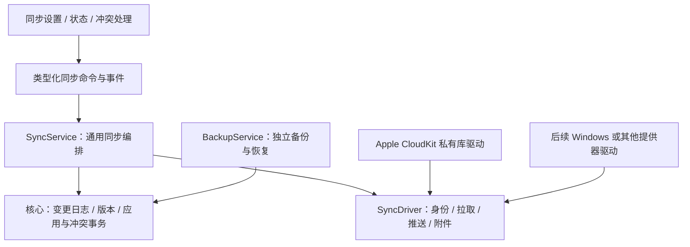

# 跨设备同步：目标与实施边界

2026-11-16。用户明确要在 Apple 设备之间通过 iCloud 接续使用同一工作区，未来考虑 Windows。手动导出、选择备份文件再恢复，不满足这个目标。

**状态：设计草案，尚未实现或启用 iCloud 持续同步。** 已上传的 1.7.7（28.1）只包含[手动备份子系统](backup-subsystem.md)，不能作为同步功能交付。当前项目没有配置私有 CloudKit 容器、同步授权或同步元数据。

## 预期体验

推荐首次在设置中开启 iCloud 同步，使用设备已登录的同一 Apple 账户关联同一工作区。其他 iPhone、iPad、Mac 开启后接着使用，无需反复导出、恢复或传输文件。不要求案笺开发者账户。

每台设备保有自己的本地工作区，离线可以继续操作。启动、回到前台和保存后的适当时机触发同步；后台执行受系统调度限制，不承诺应用被挂起时仍立即同步。界面只显示同步状态、上次成功时间，以及需要处理的冲突。

待用户选择的首次启用方式为：同 Apple 账户自动连通（推荐），或各设备显式选择同一 iCloud 云盘文件夹。两者的授权、传输和 Windows 接入方式不同，不应把后者伪装成前者。同步规则和核心数据模型应独立于这个选择。

## 统一子系统

此图描述目标，类名不是已经接通的 API。不能只创建没有调用者的空接口，再宣称支持同步。需要以完整用例和可替换测试驱动确定端口，再接真实平台。

- 核心层管理对象版本、变更序列、删除标记、应用远端变更和冲突保留，不引用 iCloud、CloudKit、Swift 或 Tauri。
- 应用层管理初始化、推送/拉取顺序、分页、重试、附件依赖、状态和生命周期，调用统一驱动；本机提交成功不依赖网络成功。
- 驱动管理服务身份、授权状态、提供器记录版本和增量令牌、网络传输、附件读写。提供器专属令牌保持不透明。
- 平台装配选择已安装驱动并发布能力；页面不得判断操作系统后拼接云路径或直接调用 Apple SDK。
- 备份负责历史快照、校验与恢复；同步负责多设备副本的持续一致。同步错误不触发静默恢复或覆盖整份本机工作区。

## 数据范围与一致性

同步案件、关键节点、日程/待办、工作记录、人员和机构、身份、对象关联、自定义属性、收支，以及材料和录音。对象继续使用稳定 UUID，不按文件名识别同一对象。设备路径、授权凭据、窗口偏好、备份位置和平台更新源属于本机状态。

不把正在使用的 SQLite / WAL 放入 iCloud 文件夹。每台设备继续使用独立 SQLite；同步对象变更和文件内容，收到的数据由核心事务写入，避免数据库文件级冲突或引用断裂。

材料使用稳定对象 ID 和内容指纹；附件完成上传后才能发布依赖它的变更。接收端先验证和暂存附件，再提交引用；未下载的附件应有明确的可用状态，不能展示已经可播放或可打开的假状态。重复传输应幂等，同一录音不因重复同步产生多份对象。

变更日志和业务写入在同一事务中提交。远端增量只有在数据/依赖/附件全部应用成功后才推进令牌。应用远端变更不会再次生成同样的本地出站变更。删除必须传播删除标记，防止离线设备重新上传旧内容导致复活。

## 冲突、身份与恢复

能证明基于同一版本且互不冲突的修改可以合并；同一属性、正文或文件的并发修改不能按本机时钟静默覆盖。保留双方版本，记录来源和关联对象，由用户在对象上下文决定。删除与编辑、关系端点删除、材料与费用引用等冲突也需明确规则。

首次连接时检查本机和云端是否已有数据。不得把一个非空工作区直接替换为另一个，也不得在后台自动合并两个身份不明的工作区。身份切换、退出 iCloud、权限撤销与空间不足都必须保留本机未同步修改；更换 Apple 账户不能把原账户数据自动上传给新账户。

备份恢复会改变工作区内容，需要与同步基线协调。恢复旧快照不应无提示地删除所有设备的新内容；恢复时须暂停同步，形成明确的新版本或单独恢复副本，之后按确定的策略重新加入同步。

## Apple 与 Windows

同账号自动连通优先评估 CloudKit 私有数据库和附件，先确认 App ID 能力、容器、发行签名权限、开发/生产环境及数据结构部署。现有 TestFlight 签名包没有相应 iCloud 权限，不能只加设置开关。iOS 最低版本当前是 15，使用新同步 API 时须提供兼容方案或明确调整支持范围。

Mac 客户端需补充自己的同步适配、签名、构建和验收。共享 Rust 核心不代表已经发布了可用 Mac 客户端。

Windows 继续实现同一 SyncDriver 契约。可评估 CloudKit Web 用户授权或增加跨平台服务驱动；不能承诺安装 iCloud for Windows 就能访问应用私有 CloudKit 数据库，也不能把应用凭据或 Apple 用户密码写入跨设备数据库。

## 交付验收

交付须实际完成两台设备间的新建、编辑、关系、属性、附件、录音和删除往返；包含断网后补传、双端并发、重复/乱序变更、附件失败、账号切换、配额不足和同步期间恢复备份。先用无平台内存驱动验证通用规则，再验证 Apple 驱动。

只有真实签名的候选成功连接生产 iCloud 环境，并完成实际账号和多设备验收后，才标记跨设备同步可用。浏览器模拟、单设备单元测试或手动备份导出均不能代替该验收。
