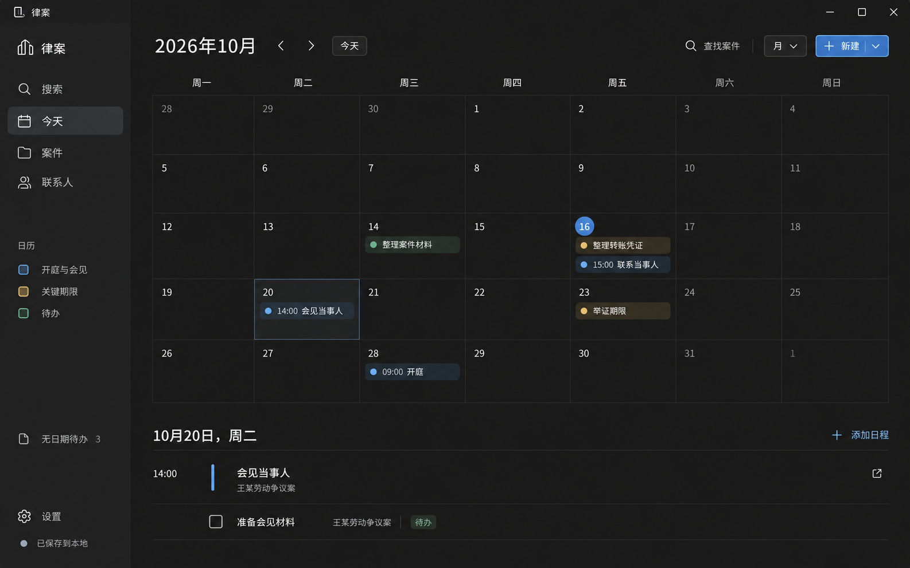
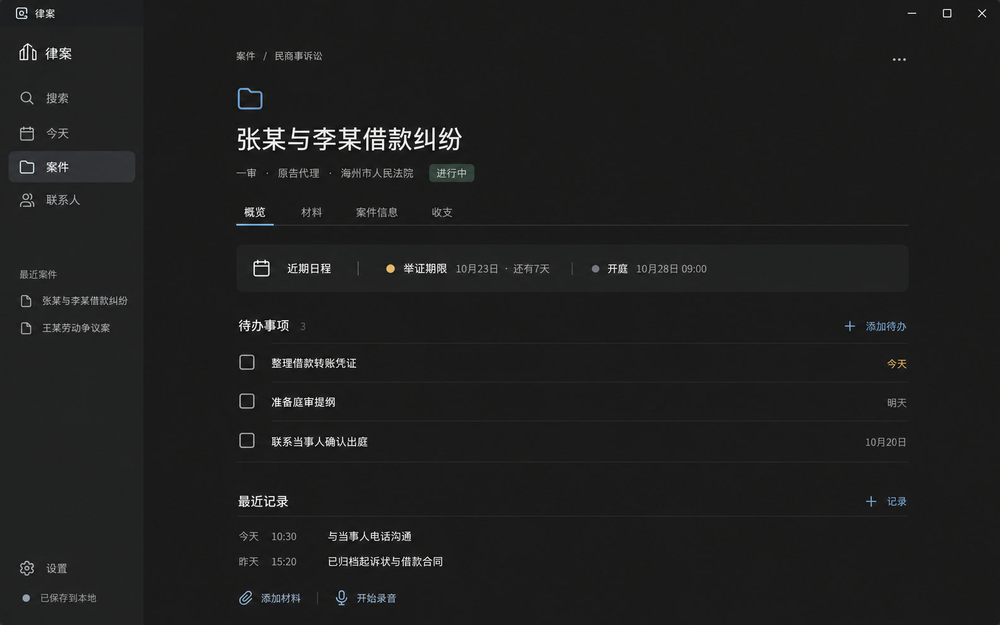
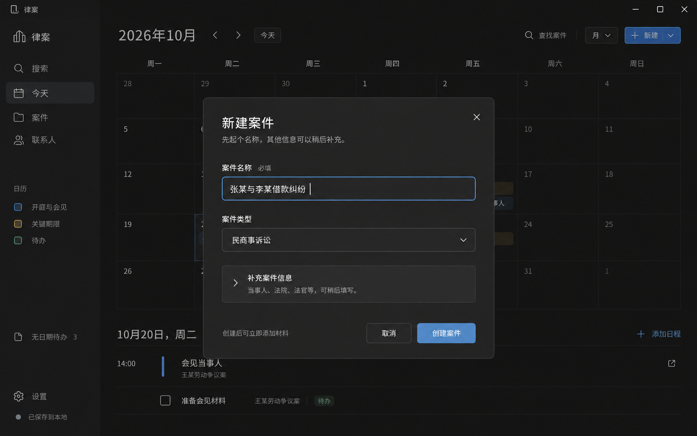

# 设计说明与高保真图

整理日期：2026 年 10 月 17 日（北京时间）。本文件记录已讨论的设计方向；页面图片为生成式高保真效果图，尚未实现为交互原型。

## 视觉原则

- 采用中性深色背景，主次文字清楚，字体轻量，标题适度。
- 通过留白、间距和对齐组织信息，减少边框、面板和常驻侧栏。
- 使用少量柔和强调色，避免大面积黄、蓝、绿区块和密集卡片。
- 参考 Apple、Notion 的视觉层级；日历布局参考 Notion Calendar。
- 首要操作有明确中文名称，避免仅用图标表达关键动作。
- 精确字体、字号、色值、响应式尺寸和键盘交互尚待实施设计，不将图片像素直接作为规格。

## 页面与交互

### 首页：月历

状态：已认可。替代此前以列表为主的首页方向。

月历展示开庭、会见、关键期限及有日期的待办；点击日期，在下方查看当天安排与待办，点击事项可进入关联案件。无日期待办独立收起展示。顶部保留查找案件和新建入口；统一搜索范围仍按需求文档覆盖联系人、法院、法官及材料文件名。

### 案件概览

状态：视觉方向已认可。

以案件名称、当前程序与阶段作为上下文。固定标签进入概览、材料、案件信息、收支。概览突出近期日程、待办和工作记录，采用宽松主内容列；不采用先前拥挤的三列看板与常驻右侧栏。

### 新建案件

状态：默认弹窗布局与信息量已认可。

入口 → 填写案件名称 → 可选调整案件类型 → 创建 → 进入案件页面。

案件类型默认民商事诉讼。通过“补充案件信息”展开可选字段，可搜索选择当事人、法院和法官；不存在时原位新增并关联。展开态和新增对象的具体界面尚未绘制。

已知图片问题：标题存在生成错字，正式产品文案统一为“新建案件”。

### 案件材料

状态：文件列表方向已确认，最新视觉稿待确认。用户因未看到首稿而要求重新生成，重新生成不代表已认可页面。

文件夹与文件统一列表展示，提供文件名搜索、新建文件夹、添加材料和拖入归档入口。导入时复制文件至案件目录，原文件保持不变。同名文件保留两份，新文件自动加编号。

PDF、图片可在软件内预览，录音可播放；Word 等由系统默认应用打开归档副本，编辑保存后直接更新该副本。预览、录音和导入进度等交互状态尚未绘制。

最新稿：

[材料页首稿](case-materials-dark-draft.png)保留供追溯；首稿中部分文件夹数量位于修改时间列，最新稿已调整。正式字段和行为以需求为准。

## 历史探索

| 图片 | 讨论结论 |
| --- | --- |
| [浅色初稿](archive/case-overview-light-v1.png) | 风格偏传统、配色不符合预期，未采纳 |
| [浅色第二稿](archive/case-overview-light-v2.png) | 字体、布局和视觉气质仍不符合预期，未采纳 |
| [深色看板稿](archive/case-overview-dark-board.png) | 风格更接近目标，但拥挤、色块过重，已被宽松列表方案替代 |
| [列表首页稿](home-dark-draft.png) | 用户建议改为日历首页，已由月历方案替代 |

所有历史图片保留原样，避免将探索稿误当作最终设计。用户提供的 Notion 截图是讨论参考，当前仓库未收录该原始附件。

## 下一步

先确认材料页；其余页面按需求逐步补齐。浅色主题暂未确定。收支、关系图、程序进度等已确认功能仍需页面设计，不能因当前效果图没有展示而视为取消。
