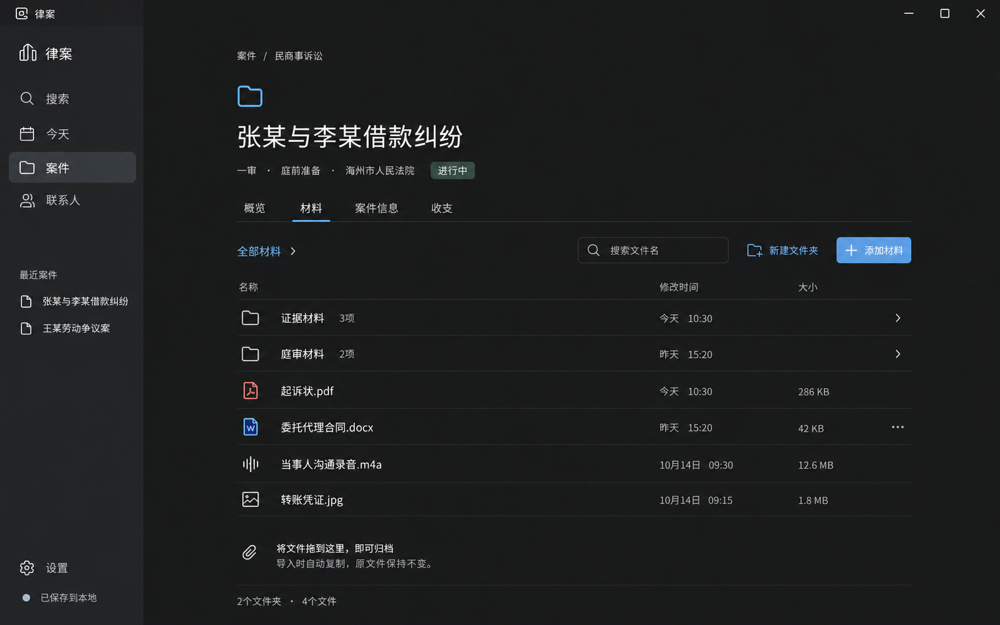

# 设计说明与高保真图

整理日期：2026 年 10 月 17 日（北京时间）。本文件记录已讨论的设计方向；页面图片包括生成式高保真效果图与 HTML 原型的浏览器截图，当前可交互部分以原型说明为准。

## 视觉原则

- 采用中性深色背景，主次文字清楚，字体轻量，标题适度。
- 通过留白、间距和对齐组织信息，减少边框、面板和常驻侧栏。
- 使用少量柔和强调色，避免大面积黄、蓝、绿区块和密集卡片。
- 参考 Apple、Notion 的视觉层级；日历布局参考 Notion Calendar。
- 首要操作有明确中文名称，避免仅用图标表达关键动作。
- 精确字体、字号、色值、响应式尺寸和键盘交互尚待实施设计，不将图片像素直接作为规格。

## 页面与交互

### 首页：月历

状态：已认可。替代此前以列表为主的首页方向。

月历展示开庭、会见、关键期限及有日期的待办；点击日期，在下方查看当天安排与待办，点击事项可进入关联案件。无日期待办独立收起展示。顶部保留查找案件和新建入口；统一搜索范围仍按需求文档覆盖联系人、法院、法官及材料文件名。

### 案件概览

状态：视觉方向已认可。

以案件名称、当前程序与阶段作为上下文。固定标签进入概览、材料、案件信息、收支。概览突出近期日程、待办和工作记录，采用宽松主内容列；不采用先前拥挤的三列看板与常驻右侧栏。

### 新建案件

状态：用户已确认当前 Notion 式右侧页内新建及提交方式，取代此前弹窗。配色、圆角、字体和图标继续保留 Notion 参考待办。

入口 → 右侧页聚焦名称 → 输入名称 → 按需补充属性；有效名称失焦、回车或关闭侧页时提交，空白草稿关闭取消。

案件类型默认民商事诉讼。通过“补充案件信息”展开可选字段，可搜索选择当事人、法院和法官；不存在时原位新增并关联。展开态和新增对象的具体界面尚未绘制。

已知图片问题：标题存在生成错字，正式产品文案统一为“新建案件”。

已在[可交互原型](../prototypes/case-board.html)补齐新建流程：[浏览器截图](explorations/create-case-browser-draft.png)。默认仅案件名称与案件类型，名称必填、类型默认民商事诉讼；创建后直接打开新案件详情，清除妨碍新案件展示的搜索条件，新案件不填入示例待办或工作记录。“补充案件信息”可展开临时字段演示，录入内容随新案件保留在内存。可选字段排布、已有对象搜索与原位新增关联仍需正式细化；当前 datalist/文本输入只作原型，不代表已经完成联系人管理。类型选项也尚非完整业务枚举。

最新 Notion 参考修订已取代上述弹窗原型：[空白侧页](../current/create-case-sidepage-v5.png)、[填写名称后](../current/create-case-sidepage-filled-v5.png)。点击新建直接打开右侧页面，名称作为可编辑页标题；左侧显示草稿条目。名称在失焦、回车或关闭侧页时写入当前内存，重复操作不会重复建案；未命名或仅含空格的新草稿关闭后丢弃。默认民商事诉讼，当事人等属性轻量展示，案号、法院、法官按需展开；这些字段仍为临时输入，不代表完成对象搜索、合并或关联管理。此自动提交流程已随当前版本获得用户确认。原型重开即重置，不具备磁盘持久化。

### 案件材料

状态：2026 年 10 月 17 日，用户确认最新稿（case-materials-dark-v2.png）的整体布局与视觉，并在后续讨论中确认 PDF、图片预览方式及文件行操作入口。首稿保留供追溯；具体操作状态仍待细化。

文件夹与文件统一列表展示，提供文件名搜索、新建文件夹、添加材料和拖入归档入口。导入时复制文件至案件目录，原文件保持不变。同名文件保留两份，新文件自动加编号。

PDF、图片可在软件内预览，录音可播放；Word 等由系统默认应用打开归档副本，编辑保存后直接更新该副本。PDF 预览已生成效果稿，图片预览、录音和导入进度等交互状态尚未绘制。

已确认的 PDF、图片预览流程：双击文件 → 在当前窗口打开宽大的预览层 → 顶部显示文件名与关闭按钮 → 关闭后回到原来的文件列表位置。PDF 支持翻页、缩放，图片支持放大查看。

PDF 预览效果稿（视觉已认可）：[宽大预览层](../current/case-pdf-preview-dark-draft.png)。顶部提供文件名、关闭、页码切换与缩放，正文展示虚构示例 PDF。内置 imagegen 生成，[生成提示词](prompts/case-pdf-preview-dark-draft.prompt.txt)一并归档；示例文书仅作视觉占位。

最新稿：

[材料页首稿](explorations/case-materials-dark-draft.png)保留供追溯；首稿中部分文件夹数量位于修改时间列，最新稿已调整。正式字段和行为以需求为准。

当前采用的文件操作菜单效果稿：[仅“⋯”入口与展开菜单](../current/case-materials-menu-dark-draft.png)。使用内置 imagegen 生成，尚非可交互实现。用户查看增加重命名图标的版本后认为冗余，明确回退到仅“⋯”的版本。[带重命名图标的探索稿](explorations/case-materials-menu-dark-v2.png)仅保留供追溯，不作为实施方向。

已确认的文件行操作入口：行尾仅保留“⋯”，不单独显示重命名或删除图标。菜单包含重命名、移动到案件内其他文件夹、导出副本和移入回收站，右键可打开同样菜单。当前方案不加入拖到垃圾箱删除。双击继续用于打开文件或进入文件夹。批量操作及各操作的具体状态后续细化；原位重命名仅曾提出，尚未确认。

### 案件列表

状态：当前中性深灰、正常可读字号、内容自适应分组的 HTML 原型已获用户暂时接受，作为继续推进的基线。配色尚未定稿，后续以 Notion 为主要参考继续打磨。以下历次效果稿按时间保留。

[案件列表效果稿](explorations/case-list-dark-draft.png)沿用宽松列表，提议提供“全部 / 进行中 / 已结案”筛选、按案件名称或案号搜索及新建案件入口。每行展示案件名称、类型与代理身份、当前程序与阶段、近期安排及“⋯”入口。点击案件进入概览；具体排序、菜单内容与多程序展示细节待细化。上述列表方案尚未作为已确认需求。

生成图把所有近期安排都呈现为黄色；实施时建议仅关键期限采用柔和强调色，普通安排使用中性色，避免过多强调。示例名称、阶段与日期均为演示数据。使用内置 imagegen，[提示词](prompts/case-list-dark-draft.prompt.txt)已归档。

卡片对比稿（已否定）：[两列宽卡片](explorations/case-cards-dark-draft.png)。用户认为卡片难看、顶部三个状态标签冗余，与整体设计语言不搭；该图仅保留为历史探索。使用内置 imagegen，[提示词](prompts/case-cards-dark-draft.prompt.txt)已归档。

用户再次提供 GitHub Projects 面板参考，希望在初版列表基础上优化分组、密度和层次。新修订稿：[进行中与已结案面板](explorations/case-status-panels-dark-draft.png)，去除顶部状态标签，将紧凑纵向条目放入两个状态面板；仅为待评审方案，不代表用户已认可。图中“联系承办法官”被生成器误加黄色强调，实施时普通安排应使用中性色；示例结案文案不改变“程序结束不等于案件结案”的业务规则。未确认拖拽改变案件状态或自定义分栏。若修订方向仍不合适，按用户要求回到[列表首稿](explorations/case-list-dark-draft.png)。内置 imagegen 生成，[提示词](prompts/case-status-panels-dark-draft.prompt.txt)已归档。

最新反馈与修订：用户指出上一版双状态面板过宽、过长，内容少却填满页面，并要求参考 GitHub 的未开始列与自定义状态列。上述双状态面板稿已否定，不再作为待选主稿。

当前效果稿（待确认）：[紧凑窄列看板](explorations/case-board-compact-dark-draft.png)。采用固定窄列“未开始 / 进行中 / 已结案”，展示“添加状态”入口；列不随窗口宽高拉伸，取消贯穿页面的面板外框，条目按内容自然排布，下方和右侧保留空白。用户明确提出自定义状态列方向，状态新增、改名、排序、删除及案件状态迁移细节尚未讨论；不将自定义案件状态等同于办理程序或程序阶段。新建案件默认归属、拖拽操作及结案规则也不因本效果稿自动确定。内置 imagegen 生成，[提示词](prompts/case-board-compact-dark-draft.prompt.txt)已归档。

最新修订（待视觉确认）：[同底色线框看板](explorations/case-board-outline-dark-v2.png)。用户要求案件页只保留一个新建入口，指出 GitHub 参考中列间分隔线及接近背景色的线框卡片更清爽。当前稿保留右上角“新建案件”，移除列下重复入口；增加细竖向列分隔线，弱化卡片底色差异，删除重复的列状态说明，收紧排版。实际实现应使用统一纯色背景和低对比细边框，生成图仍有的轻微明暗纹理不作为设计规格。使用内置 imagegen，[提示词](prompts/case-board-outline-dark-v2.prompt.txt)已归档。此反馈针对案件页，不取消首页等其他页面已确认的新建入口。

### 当前可交互视觉原型

#### 案件工作区与原有逻辑

用户提醒必须延续此前讨论的案件页逻辑。Notion 仅用于改善视觉与操作，侧页新建和快速查看不替换完整案件工作区。当前已增加“展开案件 / 收起为侧页”，展开后保留左侧应用导航，主区使用完整宽度；切换标签或程序不会丢失展开状态。原有固定“概览 / 材料 / 案件信息 / 收支”入口保留。收支仍为未实现占位，不代表功能取消。

- [案件概览实际渲染](../current/case-overview-browser-v6.png)：突出近期安排、待办和工作记录，提供材料入口与程序事件；当前程序和当前阶段轻量展示。
- [程序信息实际渲染](../current/case-program-info-browser-v6.png)：可新增或切换一审、二审、再审、执行，案号、法院、法官、事件和材料分别归属于程序，历史保留；新增程序不改变案件的进行中或结案状态。当前阶段的自由文字编辑和新增程序表单为原型提议，默认阶段管理尚未完整实现。
- [材料实际渲染](../current/case-materials-browser-v6.png)：案件共用材料与当前程序材料可切换，支持文件夹、浏览器选文件/拖入、文件名搜索、同名自动编号、菜单重命名/移动/导出、移入回收站和恢复；图片、PDF、音频可调用浏览器能力预览。列内“⋯”与材料行“⋯”保留，案件卡片仍不加菜单。
- 上传文件仅在浏览器内存中持有，不是复制归档到磁盘；关闭原型会丢失修改。桌面系统应用打开 Word 等文件、持久化、录音采集、全文之外的统一搜索及完整默认阶段操作仍待正式实现。界面截图使用虚构示例。
- 已检查程序历史及数据隔离、跨程序共用材料、同名保留、文件夹移动、删除恢复、搜索、预览关闭不退出案件、新建回归、待办勾选状态及工作区展开/收起。

**待办标记 DESIGN-NOTION-COLOR：参考 Notion，统一打磨整体配色逻辑。** 用户认可当前版本已有明显进步，同意先继续推进，但认为背景、卡片、状态色与文字的配色关系仍不够考究；当前色值不作为正式设计规范。后续应整体校准颜色层级与对比，避免每页单独选色。该标记持续保留，直到用户明确认可配色。

**待办标记 DESIGN-NOTION-DETAIL：参考 Notion 的圆角、字体与图标设计。** 后续统一卡片、按钮、标签、菜单和弹窗的圆角层级；校准字体家族、字号、字重、行高及中文呈现；统一图标的尺寸、线条、视觉重量与文字对齐。用户要求记录后继续推进，本阶段不逐项展开或将临时样式视为定稿。

用户最新反馈：此前整体过大，之后又过小、过密；不能以缩小全部元素代替设计。以用户提供的 Notion 页面作为当前主要视觉参考，强调中性深灰、适度标题、可读正文、轻量工具和组间留白。

- [打开 HTML 原型](../prototypes/case-board.html)：浏览器直接打开，无需安装依赖。
- [看板实际渲染](../current/case-board-neutral-v4.png)与[展开案件详情](../current/case-board-detail-neutral-v4.png)：CSS 视口为 1600 × 1000，截图像素比为 2。
- 案件卡片取消“⋯”，点击打开详情；列标题提供“⋯ / +”。取消右上角新建按钮，文字新建入口放在首列条目下方。列上的“+”为按列新建快捷入口，按用户后续反馈加入，取代此前仅允许单一入口的布局提议。
- 本稿探索内容自适应高度的状态分组与柔和色调，取代贯穿页面的长框；此视觉和侧开详情均待确认，不覆盖既有案件概览的已确认功能。
- 支持演示搜索、新建、添加状态、改名、列顺序调整、点击卡片及关闭详情。仅使用虚构数据，修改仅在当前打开期间有效，无数据库、文件管理或正式业务规则。详情中的标签目前只作布局展示。
- 已通过浏览器检查初始条目、搜索、详情开关、列菜单和改名表单。此前 [冷黑紧凑原型截图](explorations/case-board-browser-v3.png)仅供追溯，不作为当前方向。

## 历史探索

| 图片 | 讨论结论 |
| --- | --- |
| [浅色初稿](case-overview-light-v1.png) | 风格偏传统、配色不符合预期，未采纳 |
| [浅色第二稿](case-overview-light-v2.png) | 字体、布局和视觉气质仍不符合预期，未采纳 |
| [深色看板稿](case-overview-dark-board.png) | 风格更接近目标，但拥挤、色块过重，已被宽松列表方案替代 |
| [列表首页稿](explorations/home-dark-draft.png) | 用户建议改为日历首页，已由月历方案替代 |

所有历史图片保留原样，避免将探索稿误当作最终设计。用户提供的 Notion 截图是讨论参考，当前仓库未收录该原始附件。

## 下一步

右侧页内新建已确认，下一步完善案件内的办理程序和材料入口，配色与细节继续按 Notion 参考待办整体打磨。浅色主题暂未确定。收支、关系图、程序进度等已确认功能仍需页面设计，不能因当前效果图没有展示而视为取消。
