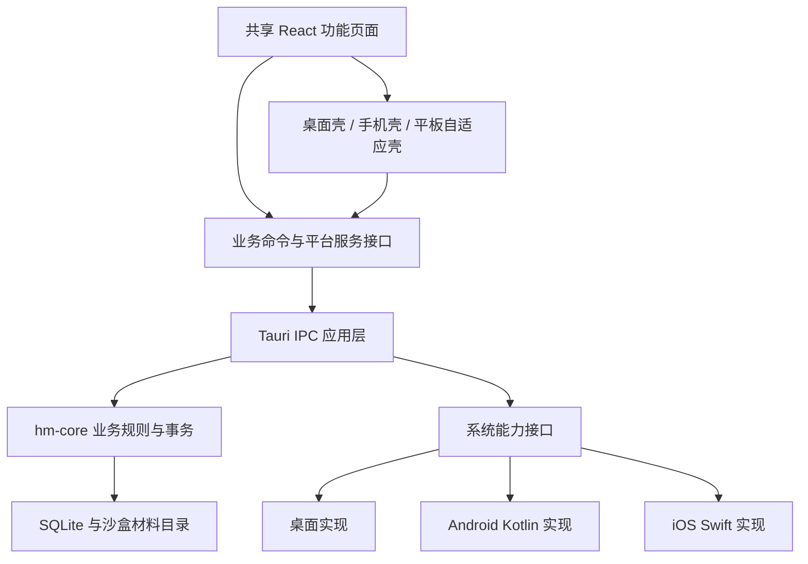

# 案笺跨平台架构

设计日期：2026-10-20。基于 main 提交 f2a1995、当前版本 1.4.3 的代码检查。本文件是待实施方案，不表示 Android 或 iOS 已通过原生构建和实机验收。

后续实现进度见[子系统边界与运行时](subsystems.md)。下方“当前实现与缺口”保留设计开始时的检查依据，desktop.rs 已在第一步拆为 subsystems/，移动宿主与原生桥接仍待完成。

## 结论与范围

继续使用 Tauri 2 + React/TypeScript + Rust/SQLite，保留同一业务模型、迁移和材料存储规则。桌面与移动端共享业务，分别适配交互壳与系统能力。暂不引入第二套 React Native/Flutter 应用，也不增加云同步。

iOS 可以进入适配阶段，先做到可编译、可启动、案件数据可持久化，再贯通文件、提醒和录音。Linux 云环境能验证共享业务与前端；iOS 原生编译、模拟器和签名须使用 macOS/Xcode，真机安装与 TestFlight 需要相应 Apple 签名配置。桌面浏览器的手机尺寸检查不能代替移动设备验收。

## 当前实现与缺口

| 代码依据                                                   | 已有基础                              | 仍需解决                                                              |
| ---------------------------------------------------------- | ------------------------------------- | --------------------------------------------------------------------- |
| `src-tauri/src/lib.rs`                                     | mobile_entry_point、共享 Store 和命令 | 无条件注册桌面插件、关闭隐藏和 desktop::setup；移动启动需剥离         |
| `src-tauri/Cargo.toml`                                     | staticlib/cdylib/rlib、hm-core        | tray-icon、单实例、自启动、updater 尚未按桌面目标隔离                 |
| `src-tauri/tauri.android.conf.json`、`tauri.ios.conf.json` | 平台配置占位                          | 仍为旧产品名；没有原生工程和构建验收证据                              |
| `src/services/repository.ts`                               | 类型化 command、明确的开发内存预览    | desktopRuntime 实际仅代表 isTauri，不能区分手机与桌面                 |
| 窄屏 CSS、案件关闭按钮和 mobile-utilities                  | 已有移动布局与触摸基础                | 系统返回、安全区、键盘、页面恢复需原生验证                            |
| `src-tauri/src/subsystems/documents/mod.rs`                | UUID 复制归档、asset 预览、完整备份   | 选择器结果统一 into_path，不能据此保证 Android URI/iOS 文档提供器可用 |
| `src/features/materials/Recorder.tsx`                      | WebView 前台录音                      | 仅 WebM/Opus，整段录音经 JS 内存和 IPC，不适合作为跨平台唯一实现      |
| `src-tauri/src/desktop.rs`                                 | 每分钟提醒、自动备份、签名更新        | 手机挂起后线程不保证运行，不能承担移动端提醒或每日定时备份            |
| `.github/workflows/ci.yml`                                 | 前端、Linux 核心、Windows 编译        | 尚无 Android/iOS/macOS 原生检查                                       |

当前远端仅发现 main。已有安卓工作中的窄屏设计继续复用；如原生适配保存在其他未提交工作区，合并前需核对，不能据当前仓库认定 APK 已可用。

## 分层与依赖方向



- hm-core 不依赖 Tauri、WebView、Swift 或 Kotlin，继续负责案件、流程、权限范围校验、整数金额、迁移、材料归档、备份校验和恢复。
- IPC 应用层协调系统输入和核心事务，统一取消、错误、进度和清理；长时文件操作不持有全局 Store 锁。
- 原生适配器只处理平台资源，不另建业务数据库，不在 Kotlin/Swift 重写收费和案件逻辑。
- 页面只依赖业务 command 与平台服务，不直接导入窗口、文件选择和原生录音 API。纯日期、金额、筛选工具仍放 domain。
- 保留当前开发 preview 适配器；生产环境缺失能力时明确呈现不支持或权限错误，绝不回退到内存数据。

建议渐进形成以下目录，不为目录调整而一次搬动现有业务：

```text
src/services/repository.ts        # 业务命令，保留现有调用契约
src/platform/                    # capabilities、files、recording、lifecycle、notifications
src/shell/                       # desktop、mobile、adaptive navigation
src-tauri/src/platform/          # desktop、mobile，共用应用启动边界
src-tauri/src/application/       # 导入、导出、提醒协调与备份作业
plugins/hm-platform/             # 仅现有插件无法满足时增加 Swift/Kotlin 桥接
crates/hm-core/                  # 共享业务与存储
```

先逐项核实 Tauri 当前锁定版本插件的目标支持和真实行为；现有插件满足要求时直接包装，缺口再实现自定义插件。不能仅以插件安装成功认定平台支持。

## 能力契约

Rust 启动后返回版本化 `PlatformCapabilities`，前端不靠 UA 或屏宽推断操作系统。屏宽只决定布局；权限状态与设备能力分别查询。

```ts
type PlatformCapabilities = {
  version: 1;
  os: 'windows' | 'macos' | 'linux' | 'android' | 'ios';
  shell: 'desktop' | 'mobile';
  files: { import: boolean; export: boolean; externalEdit: boolean };
  recording: 'webview' | 'native' | 'unavailable';
  reminders: 'desktop-loop' | 'os-scheduled' | 'unavailable';
  updates: 'signed-updater' | 'store' | 'manual';
  tray: boolean;
  autostart: boolean;
};
```

接口分别返回 `cancelled`、`permissionDenied`、`unsupported`、`unavailable`、`failed`，并携带可展示错误信息。用户取消不作为错误提示；权限拒绝提供系统设置入口。能力标记用于正确呈现入口，Rust 命令仍独立校验，不能靠隐藏按钮保护执行。

把 `desktopRuntime` 渐进改为 `nativeRuntime`，然后逐处按能力控制拖入、主题窗口设置、更新监听、自启动和退出。所有平台共用业务 command；平台独有命令在对应目标注册，前端不得调用未注册命令。

## 启动、构建和生命周期

1. Cargo 将 tray-icon、autostart、single-instance、updater 放入明确的桌面目标依赖/特性；Rust 用 cfg(desktop)/cfg(mobile) 隔离模块、插件注册与命令。核对 Tauri 对自定义 cfg 的支持，不能只在运行时判断。
2. 共享初始化仅包含沙盒定位、迁移、Store、业务命令和必要文件服务。移动端不探测 exe 附近的 portable 目录，不创建桌面窗口配置，不设置关闭到托盘。
3. 桌面保留现有安装身份与数据目录。Android/iOS 使用系统应用私有持久目录，临时文件单独存储且可清理；业务数据库不得存缓存目录。
4. 建立 foreground/background、resume 和 Android back 事件。恢复前台时重新读取业务数据、检查到期提醒、协调通知和机会式备份；持久化不能依赖退出回调。
5. 基础配置保留共用项；平台覆盖桌面窗口、bundle、更新和插件配置。Android/iOS 配置统一产品名，补齐最小系统版本、图标、权限说明、包身份和签名配置。分别验证合并后的配置，避免沿用 NSIS/updater 资源。
6. 初期业务事务继续串行访问 Store。文件选择、跨提供器复制、压缩和系统交互在锁外完成，只在最终校验/提交时进入核心；避免大文件阻塞日程保存。

## 材料与备份：系统资源先进入沙盒

统一流程：选择系统资源 → 原生桥分块复制至应用暂存区 → 获得不透明 stagingId → 核心校验目标和名称 → UUID 归档并提交业务 → 清理暂存。

- Android 使用系统文档选择器/SAF，支持 content URI；通过 ContentResolver 流式读取，不把 URI 转成伪文件路径。复制归档后不再依赖长期 URI 权限。
- iOS 使用文档选择器，访问外部提供器时管理 security-scoped 资源生命周期，并处理尚未下载的文件。优先复制进沙盒，成功或取消后释放访问；不持久化外部绝对路径作为材料标识。
- stagingId 由原生层签发并绑定当前作业，不能作为任意路径入口；失败、取消和启动时回收过期暂存。重试沿用稳定导入 ID，保留现有凭据导入的幂等规则。
- 大文件使用原生流式 I/O，报告字节进度与剩余空间错误，不经 base64 或完整 JS ArrayBuffer。中断文件不得作为已归档材料出现。
- 预览继续使用材料 ID 和受限 asset 访问；沙盒绝对路径只在内部解析。移动系统打开默认导出副本或分享，明确不保证外部 Office 修改自动回写。
- 移动备份首先复用核心完整目录格式和 SHA-256 校验；增加可移植归档容器，经分享/文档选择器导出和导入。导入先安全解包到暂存，限制条目数/总大小、拒绝路径穿越和符号链接，再调用现有检查及恢复流程；不能直接打开外部提供器中的 SQLite。
- 跨平台恢复保留 ID、日期和材料引用，重新定位沙盒根目录；备份位置、自启动、更新源等设备配置不直接覆盖目标平台设置。核对文件名、大小写、保留名和 Unicode 差异，遇冲突明确报告。
- 备份兼容格式显式版本化；只有新增业务字段才升级数据库，不为 UI 或平台能力变化修改 schema。自动本地副本仍位于同一设备，设置中说明设备丢失需另行导出备份。

## 日程、提醒和时间

继续沿用现有墙上时间与全天日期语义，不在适配时静默转换已有日程。移动端用 OS 本地通知调度未来提醒，不依赖一分钟 Rust 循环；iOS 不承诺应用退出后任意后台代码运行，Android 也不以常驻线程替代系统调度。

保存、修改、删除日程后在事务提交后协调通知；数据库为真源，使用稳定 eventId + scheduleKey 记录调度映射，失败进入可重试待协调状态。取消旧通知、更新新通知必须可重试，恢复/迁移后重建调度。系统调度成功仅代表已安排，不代表用户已看到或已处理，不能直接复用 acknowledge_reminder 标记实际送达。

iOS 仅安排系统允许数量内的最近提醒并在前台补齐；长期不打开可能无法覆盖所有远期事件，产品明确限制。Android 按系统版本处理通知权限、重启恢复和精确闹钟权限，不保证无授权时精确到分钟。权限拒绝仍保留应用内通知中心。

设备时区/时间变化时重新协调；跨时区跟随当地时间还是固定事件时区属于后续业务决策，首版明确沿用当地墙上时间。自动备份改为启动/恢复/活跃期间按日检查，不宣传移动端每天固定时间必定执行。

## 录音与隐私

桌面保留当前 WebView 实现作为可用适配器；移动端优先原生前台录音，iOS 使用系统音频会话，Android 使用相应录音与权限 API。MIME、编码、扩展名由实际能力返回；优先验证 AAC/M4A，不能硬编码 WebM 或把其他编码改扩展名。

原生分段写沙盒暂存，保存时走同一材料归档流程。明确处理电话/音频中断、耳机切换、权限拒绝、锁屏、后台和空间不足；尽量保留可恢复片段。首版不承诺后台录音，不擅自增加音频后台模式；不支持继续录制的状态及时停止并提示。暂存录音恢复与丢弃都需用户可见，不因切换页面悄悄丢失。

配置 iOS 麦克风用途说明、Android 录音权限和必要系统提示。默认保持离线；系统云备份可能与“不接入应用云同步”不同，需明确制定私有数据库/材料的系统备份策略并在设备测试，不能把本地离线等同于系统永不上传。首版优先排除业务目录的自动云备份，以用户主动导出备份为准；不声明尚未实现的数据库加密。

## 移动与平板交互

- 桌面保留侧栏、看板和案件侧页；手机使用稳定主导航与全屏案件页，平板按可用宽度恢复分栏。共用功能组件和表单，布局容器分别实现。
- 布局用容器/视口断点，触控目标按输入方式增大；触摸设备提供“移动到状态”等显式菜单，不把拖拽/悬停作为唯一入口。
- 增加 viewport-fit、安全区和动态视口适配，验证刘海、Home 指示条、横屏、软键盘、表单焦点与底部提交区。保持现有字体层次，不通过整体缩字适配小屏。
- Android 系统返回/iOS 导航返回依次关闭顶层弹层、退出子页面；有待保存字段时沿用保存成功后离开的规则。订阅与监听随页面清理，前后台切换不重复注册。
- 手机关系图保留选择、详情和列表入口；多指缩放/拖动不阻断页面滚动与辅助访问。日历保留共享数据，手机默认日视图并可切换。
- 移动设置不显示托盘、自启动、桌面安装更新；显示通知权限、存储用量、导出备份和应用商店更新入口。暂不做照片扫描、分享扩展或跨设备同步。

## 实施顺序与交付门槛

| 阶段            | 工作                                                                 | 完成条件                                                                    |
| --------------- | -------------------------------------------------------------------- | --------------------------------------------------------------------------- |
| P0 共享边界     | 能力接口、拆分 desktop/mobile 启动、目标依赖与配置、前端平台调用收口 | Windows 原有检查保持通过；Android/iOS 原生最小启动与 SQLite 写入重启验证    |
| P1 移动日常使用 | 手机壳、安全区、返回/键盘、文件导入导出、沙盒备份恢复                | 两平台真机完成建案→文件→重启→备份恢复；拒绝权限、取消和大文件中断有清晰结果 |
| P2 系统体验     | OS 通知协调、生命周期恢复、原生录音                                  | 两平台覆盖后台/锁屏/中断/时间变化；不重复提醒，录音可保存恢复               |
| P3 分发         | 图标、权限说明、隐私说明、签名、TestFlight/Android 内测              | 隔离测试数据、安装升级保留业务数据、产物可追溯到源码与验证记录              |

优先交付 P0，再由 Android 和 iOS 分别完成原生验收，避免把某一平台通过当作另一平台完成。首个 iOS 内测包可先验证 P0/P1，未完成录音和提醒明确标记；正式移动发布应完成全部适用门槛。

## CI 与验证责任

保留 Linux 的前端构建/逻辑测试、hm-core 真实 SQLite/备份回归和 Windows 桌面构建。拆分平台后新增独立 Android 构建任务、macOS 桌面任务与 macOS runner 上的 iOS 模拟器构建；固定 Node 22、Rust、JDK/NDK、Xcode 版本并记录工具链升级。交叉编译 hm-core 只能作为早期检查，不替代完整 Tauri 原生构建。

无签名 PR 检查不需要发布凭据；设备/商店分发在受控发布任务中配置签名。CI 不提交凭据，不在不可信 PR 上注入签名，不自动发布到商店。

云端验证共享逻辑与多尺寸页面；Android 模拟器/iOS 模拟器验证原生启动、桥接和持久化；真实设备验证文档提供器、麦克风、通知、锁屏和系统恢复。旧库迁移、中文文件、长文件名、跨平台完整备份恢复及卸载前数据导出都列入移动验收。所有测试使用隔离虚构数据。

## 暂缓与待核实

首期不承诺跨设备实时同步、自动合并备份、iCloud/Android 云备份、后台录音、共享扩展、扫描 OCR、后台绝对准时备份。Mac Catalyst 不作为默认路线；iPad 通过 iOS 应用的自适应布局验证。

进入 P0 时需实际核实锁定插件的移动支持、iOS 最低版本、Android target/min SDK、可用 macOS/Xcode runner、Bundle ID 对应签名与 Apple 开发者账号。原生工程生成、插件原型和设备结果出来后更新本文件，不用未经验证的插件能力补全验收记录。
