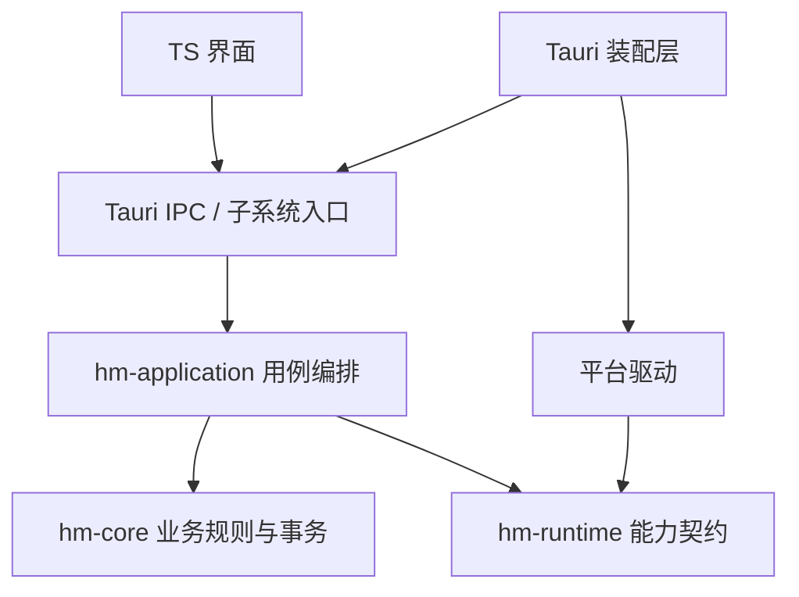

# Rust 能力接口与驱动分层

核心业务只依赖稳定的业务模型和字节流。应用层依赖能力接口，驱动实现接口，Tauri 负责装配与 IPC。新增平台对已有能力的支持通常只需要新增驱动及装配；新增业务规则或无法由旧契约表达的能力仍需扩展相应层。

## 依赖方向



hm-core 不依赖 hm-runtime、hm-application 或 Tauri；hm-application 不依赖 Tauri、操作系统 SDK 或平台驱动。驱动不决定案件归属、材料命名冲突和事务规则。

## 当前目录

```text
crates/
  hm-core/src/materials.rs       import_reader：流式归档、校验、失败清理
  hm-application/src/
    documents.rs                资源导入、逐文件错误汇总、释放访问资源
    recording.rs                会话编排、状态检查、归档失败保留产物
    speech.rs                   设备内转写任务、草稿保存
    backup.rs                   完整备份文件传输、待确认恢复令牌
  hm-runtime/src/platform/
    documents.rs                Document / DocumentDriver 契约
    backup.rs                   BackupDriver / FileBackupDriver 契约
    speech.rs                   SpeechDriver / SpeechJob 契约
    recording.rs                RecordingDriver / RecordingSession 契约
    error.rs                    标准驱动错误分类
    ports.rs                    Host / ExternalOpen / LocalFilesystem 独立接口
    capabilities.rs             底层能力校验
    sandbox.rs                  未接入的宿主和本地文件系统能力
src-tauri/src/
  lib.rs                        组装与命令注册
  ipc/                          工作区、宿主 IPC
  subsystems/
    documents/                  文档 IPC、预览和旧凭据入口
    recording/                  原生及兼容录音服务与 IPC
    speech/                     转写服务与 IPC
    backup/                     本机/文件备份与恢复 IPC
    host/                       桌面宿主生命周期
    updates/                    更新检查与安装
    maintenance/                备份和提醒协调
  platforms/
    mod.rs                      驱动选择、注入与能力声明
    desktop/documents.rs        对话框、文档流、临时文件完成后导出
    desktop/mod.rs              宿主、本地目录和系统打开实现
    desktop/windows_icon.rs     Windows Shell / 任务栏实现
    mobile/documents.rs         显式返回不支持，等待真实原生桥接
src/platform/
  recording.ts                  录音 IPC 客户端、按 Rust 描述选择后端
  recording-webview.ts          旧 WebView 录音兼容实现
```

## 文档契约

Document 是不透明资源，不是可跨平台传递的路径。它拥有名称，并能从头打开读取流；借用流不能超过资源的生命周期。驱动持有提供器的访问许可，在资源释放时撤销。Android URI、iOS 安全访问和桌面路径都封装在驱动内。

材料导入：TS → pick_materials → DocumentDriver::pick → hm-application::documents → Store::import_reader。拖入路径仅在桌面入口转换成 Document，此后的业务流程相同。归档后的文件使用应用内部存储，继续由 hm-core 管理。

导出：Store 校验并定位已归档材料 → DocumentDriver::export。接口接收名称与读取流，不要求目标提供器有本地路径。桌面实现先完整写入同目录临时文件、同步，再替换目标；读取失败不会提前覆盖原文件。

选择器返回 None 表示取消；权限拒绝、中断、不支持、状态错误和 I/O 失败由标准 DriverError 分类。文档、录音和宿主驱动 IPC 保留结构化错误字段；前端统一将错误码翻译为中文。旧业务校验通过显式 legacy_error 路径保留原提示，尚未全部迁移。原生选择器标题通过 dialogTitle 从前端语言资源传入。

## 录音契约

RecordingDriver 提供能力描述和开始会话；RecordingSession 提供状态、暂停、继续、结束和取消，负责在 Drop 时释放麦克风。结束返回 Document 产物，不假定 WebM，也不暴露原生临时路径。

RecordingService 拒绝重复开始和非法暂停，结束后释放会话、保留产物。归档失败保留产物，重试从头读取；归档成功或取消后释放产物。TS 界面通过统一控制接口操作，会根据返回产物保留对应扩展名，不固定要求 WebM。

iOS 已接入 AVFoundation 原生录音驱动，支持权限、暂停与中断；桌面显式允许 WebView 兼容后端，Android 尚未安装原生录音驱动，不启用移动 WebView 回退。参见[设备内转写](../speech-transcription.md)和[备份与录音分层核对](../backup-subsystem.md)。

录音驱动已有 iOS 模拟器原生测试；真实设备权限、中断、格式与生命周期验收仍需按实际构建完成。

## 有意保留的迁移边界

旧凭据附加和桌面备份目录选择仍使用 LocalFilesystemDriver。完整备份已新增独立 BackupService / BackupDriver 文件传输，iOS 和桌面通过 DocumentDriver 提供器接入，Android 不开放尚未安装的能力。详见[备份子系统](../backup-subsystem.md)。

host、updates、maintenance 仍含部分 Tauri 生命周期和 IPC，暂未全部提炼为独立能力端口。后续按真实功能需要拆分，不创建无人调用的接口或空的平台目录。

## 验证

hm-application 的无平台测试使用内存提供器和测试录音驱动，覆盖无本地路径归档、提供器读取中断清理、资源释放、录音状态控制和归档失败重试。现有 hm-core SQLite / 备份回归继续运行；CI 加入应用层测试及 Clippy。

## 错误与本地化

驱动返回 code、kind、resource 和可选 detail，不在驱动中拼接中文提示。detail 用于诊断，普通错误不会直接向用户展示；只有显式 legacy_error 兼容旧业务校验提示。

前端 src/i18n/zh-CN.ts 保存错误文案、能力名称和原生对话框标题；src/platform/ipc.ts 统一将 IPC 拒绝转换为可读 Error，同时保留机器字段。批量导入逐项返回 name 和结构化 error，文件名作为数据保留原文。

本轮已迁移新驱动接口、原生录音会话和文档操作入口。hm-core 的既有 Validation(String)、旧更新与维护提示仍有中文文案，后续需按业务类别逐步改为稳定错误码。品牌名称、历史安装路径以及用户内容不做英文改名。

## 驱动接入与同步准备

现有录音、文件、转写及新 CloudKit 的 Rust/Swift 位置见[平台驱动地图](platform-driver-map.md)。同步内核和 iOS 驱动正在准备，真实账号、容器及生产权限尚未接通，不等同于已发布云同步。
