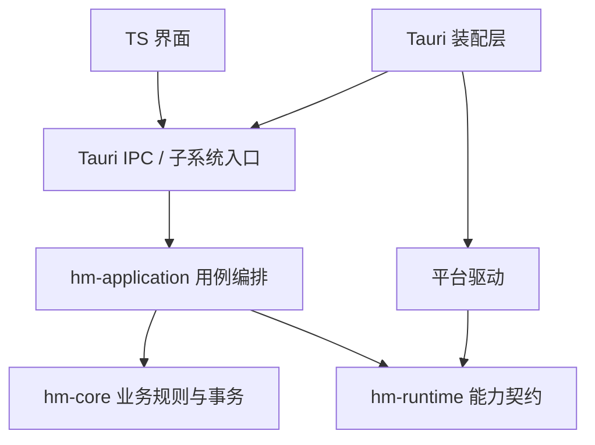

# Rust 能力接口与驱动分层

核心业务只依赖稳定的业务模型和字节流。应用层依赖能力接口，驱动实现接口，Tauri 负责装配与 IPC。新增平台对已有能力的支持通常只需要新增驱动及装配；新增业务规则或无法由旧契约表达的能力仍需扩展相应层。

## 依赖方向



hm-core 不依赖 hm-runtime、hm-application 或 Tauri；hm-application 不依赖 Tauri、操作系统 SDK 或平台驱动。驱动不决定案件归属、材料命名冲突和事务规则。

## 当前目录

```text
crates/
  hm-core/src/materials.rs       import_reader：流式归档、校验、失败清理
  hm-application/src/
    documents.rs                资源导入、逐文件错误汇总、释放访问资源
    recording.rs                会话编排、状态检查、归档失败保留产物
  hm-runtime/src/platform/
    documents.rs                Document / DocumentDriver 契约
    recording.rs                RecordingDriver / RecordingSession 契约
    error.rs                    标准驱动错误分类
    ports.rs                    Host / ExternalOpen / LocalFilesystem 独立接口
    capabilities.rs             底层能力校验
    sandbox.rs                  未接入的宿主和本地文件系统能力
src-tauri/src/
  lib.rs                        组装与命令注册
  ipc/                          工作区、宿主 IPC
  subsystems/
    documents/                  文档 IPC、预览、旧凭据和备份入口
    recording/                  原生录音服务与 IPC
    host/                       桌面宿主生命周期
    updates/                    更新检查与安装
    maintenance/                备份和提醒协调
  platforms/
    mod.rs                      驱动选择、注入与能力声明
    desktop/documents.rs        对话框、文档流、临时文件完成后导出
    desktop/mod.rs              宿主、本地目录和系统打开实现
    desktop/windows_icon.rs     Windows Shell / 任务栏实现
    mobile/documents.rs         显式返回不支持，等待真实原生桥接
src/platform/
  recording.ts                  录音 IPC 客户端、按 Rust 描述选择后端
  recording-webview.ts          旧 WebView 录音兼容实现
```

## 文档契约

Document 是不透明资源，不是可跨平台传递的路径。它拥有名称，并能从头打开读取流；借用流不能超过资源的生命周期。驱动持有提供器的访问许可，在资源释放时撤销。Android URI、iOS 安全访问和桌面路径都封装在驱动内。

材料导入：TS → pick_materials → DocumentDriver::pick → hm-application::documents → Store::import_reader。拖入路径仅在桌面入口转换成 Document，此后的业务流程相同。归档后的文件使用应用内部存储，继续由 hm-core 管理。

导出：Store 校验并定位已归档材料 → DocumentDriver::export。接口接收名称与读取流，不要求目标提供器有本地路径。桌面实现先完整写入同目录临时文件、同步，再替换目标；读取失败不会提前覆盖原文件。

选择器返回 None 表示取消；权限拒绝、中断、不支持、状态错误和 I/O 失败由标准 DriverError 分类。现有文档 IPC 为兼容前端继续传递错误消息，不改变已有业务命令参数。

## 录音契约

RecordingDriver 提供能力描述和开始会话；RecordingSession 提供状态、暂停、继续、结束和取消，负责在 Drop 时释放麦克风。结束返回 Document 产物，不假定 WebM，也不暴露原生临时路径。

RecordingService 拒绝重复开始和非法暂停，结束后释放会话、保留产物。归档失败保留产物，重试从头读取；归档成功或取消后释放产物。TS 界面通过统一控制接口操作，会根据返回产物保留对应扩展名，不固定要求 WebM。

当前原生驱动为 UnavailableRecording，返回 capture=false；桌面显式允许原有 WebView 兼容后端，移动端不启用该回退。Swift/Kotlin 或桌面原生音频驱动尚未接入，不能把接口和测试驱动当成已具备原生录音。

原生录音的 IPC 和界面调用链已接好。真实驱动接入时，还需完成设备权限、中断状态展示、格式与生命周期的设备验收。

## 有意保留的迁移边界

凭据附加和备份目录选择仍使用 LocalFilesystemDriver 的本地路径契约；它们没有被宣称为通用文档提供器功能。移动端接入这些功能时，需将凭据流程迁移为资源导入，备份迁移为归档传输。

host、updates、maintenance 仍含部分 Tauri 生命周期和 IPC，暂未全部提炼为独立能力端口。后续按真实功能需要拆分，不创建无人调用的接口或空的平台目录。

## 验证

hm-application 的无平台测试使用内存提供器和测试录音驱动，覆盖无本地路径归档、提供器读取中断清理、资源释放、录音状态控制和归档失败重试。现有 hm-core SQLite / 备份回归继续运行；CI 加入应用层测试及 Clippy。
