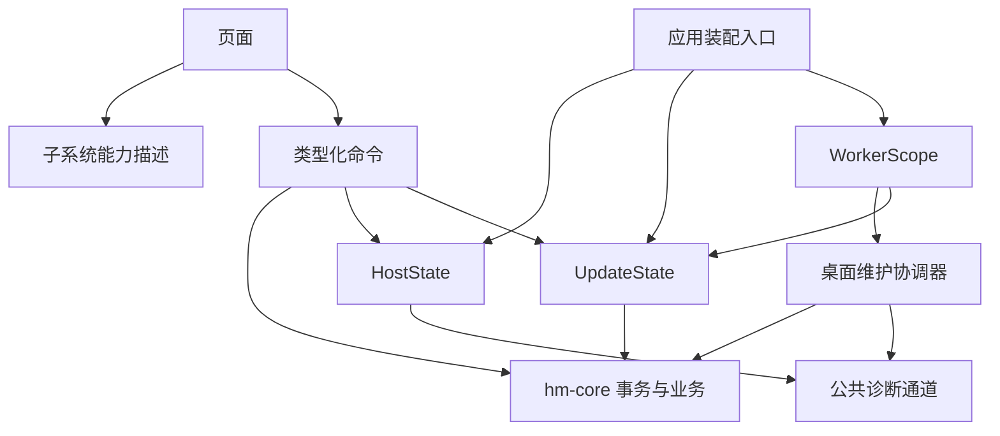

# 子系统边界与运行时

2026-10-20。补充[跨平台架构](cross-platform-architecture.md)，记录本次实际实现与后续提炼边界。

## 设计原则

子系统是拥有一组职责、接口、状态和生命周期的模块。业务子系统与系统适配器分开：案件和收费规则不因操作系统改变；文件提供器和通知调度可以替换实现。采用显式调用与编译期装配，不增加动态插件发现、服务定位器或通用事件总线。

查询返回当前状态，命令执行校验后的动作，事件只通知状态变化。SQLite 是业务真源；事件漏收后可重新查询恢复。跨子系统业务写入沿用核心事务，不以异步事件代替事务。

## 职责划分

| 子系统 | 拥有的职责与数据 | 对外接口 | 平台差异 |
| --- | --- | --- | --- |
| 工作区 | 案件、流程、阶段、参与人、工作关联和收费规则 | 现有类型化业务命令 | 无，继续由 hm-core 校验和事务保存 |
| 文档 | UUID 材料对象、归档目标、暂存导入、预览与导出 | 导入/预览/导出；后续 stagingId 契约 | 桌面路径、Android URI、iOS 文档提供器 |
| 日程提醒 | 日程和提醒键、通知协调状态 | 业务保存、到期查询、送达确认；后续系统调度端口 | 桌面轮询或移动 OS 调度 |
| 备份 | 一致快照、材料清单、校验和恢复日志 | 现有完整备份/检查/恢复；后续归档传输 | 目录选择或系统分享 |
| 录音 | 录音会话、暂存片段和中断恢复 | 开始/暂停/停止/归档 | WebView 或原生音频实现 |
| 宿主 host | 窗口、托盘、自启动、原生拖入能力 | 宿主命令和能力描述 | 桌面宿主与移动导航/生命周期 |
| 更新 updates | 检查互斥、可用版本、待安装包、进度 | 检查/查询/确认安装与更新事件 | 签名更新或应用商店 |

文档、备份、录音仍沿用已有业务模块和入口；上表是逐步收口的目标，不代表七个子系统均已重构完成。第一步提炼宿主、更新和后台协调，第二步隔离移动启动与桌面依赖，并把前端原生 API 收口到 platform 适配模块。

## 本次实现

```text
crates/hm-runtime/
  src/lib.rs                   能力与子系统状态契约，不依赖 Tauri/SQLite
  src/lifecycle.rs             周期任务作用域与停止信号
src-tauri/src/subsystems/
  mod.rs                       桌面装配入口、manifest 查询、退出停止
  host.rs                      窗口/图标/托盘/自启动，拥有 HostState
  updates.rs                   更新服务，拥有 UpdateState
  maintenance.rs               备份与提醒的桌面周期协调器
  health.rs                    诊断快照与通知通道
  mobile.rs                    移动启动/恢复前台与备份机会
src/platform/
  subsystems.ts                前端能力契约与支持判断
  SubsystemProvider.tsx        获取当前运行时描述，供页面消费
```

hm-core 不依赖 hm-runtime；两者由 Tauri 应用层装配。hm-runtime 不依赖宿主 API，Android/iOS 可以复用契约和生命周期工具，但不应复用桌面的长期轮询策略。



宿主不访问更新状态；更新不访问宿主可变状态。图标和维护错误通过公共诊断通道汇总，不互相锁定状态。诊断锁在发事件前释放。

### 生命周期

装配顺序为诊断通道 → 宿主 → 更新状态/周期检查 → 周期维护 → 发布 manifest。若宿主安装失败，应用启动报错，不发布 ready；若创建工作线程失败，已创建的作用域在释放时通知停止。

更新仍在启动 15 秒后检查、之后每 6 小时检查；维护仍每分钟执行。等待使用可唤醒的停止信号，替代不可取消的 sleep 循环。应用真正 Exit 时通知停止；关闭窗口到托盘不会停止服务。已获准执行的一轮可以结束，不在 UI 退出回调同步等待网络操作；原有网络检查超时继续生效。作用域 Drop 同样发出停止信号。

本次并未将托盘隐藏等同于应用挂起，也没有为 iOS 启用后台轮询。移动端后续需单独装配前台维护与系统通知调度。

### 能力与状态

新增 `subsystem_manifest` 命令，版本为 1；每个描述包含稳定 id、ready/unsupported 状态和 capability 列表。描述现包括 host、updates、maintenance、documents、recording、backup；文档/录音仍为适配能力描述，业务模块尚未全部提炼；“ready”代表适配器安装成功，不代表用户已授予通知等系统权限，也不保证网络检查成功。

前端仅在状态 ready 且能力被明确列出时启用托盘、自启动、原生主题、原生拖入和签名更新入口。尚未查询到能力、版本不兼容或查询失败时默认关闭这些入口；设置页显示读取错误，业务设置仍独立读取。开发 preview 显式模拟桌面能力，用于现有界面回归，不作为真实平台能力证明。

`nativeRuntime` 只表示存在 Tauri IPC，替代原来误导性的 desktopRuntime。它不再承担桌面能力判断。现有业务/文件命令保持名称不变，避免拆分引入数据格式或业务 IPC 迁移。

### 后台协调

maintenance 是调用备份、提醒与系统通知的应用服务，不拥有新的备份库或提醒表。本次保持已有事务与送达行为；维护周期出错时新增 maintenanceError 诊断，避免整体失败被静默丢弃。

后续应把外部通知发送移出 Store 锁，并建立可重试协调状态；移动“调度成功”不等同于桌面的“发送成功”。该行为变化须配套核心测试和必要的数据迁移，不能仅更名复用现有送达标记。

## 后续实施规则

1. 文档子系统先统一暂存资源句柄和分块复制，再接 Android/iOS 文件提供器；归档事务继续复用核心。
2. 提炼通知发送/系统调度端口，日程保存后提交可恢复协调动作；不让每个页面自行调度通知。
3. 备份子系统区分创建/校验/恢复与设备外导出；录音子系统区分会话和归档，不让 UI 拼接不同编码的文件名。
4. 已按目标隔离 Cargo 桌面依赖、插件、IPC 和宿主装配，并提供移动 manifest；Android Rust 库交叉检查通过，iOS 原生编译结果见远端 CI，完整应用和设备验收仍待完成。
5. 前端窗口、事件、拖入、asset URL 与录音 IPC 已集中到 platform 目录；后续 Android/iOS 桥接在此替换适配器，不把原生 API 放回业务页面。

数据模型只为业务变化迁移，不为模块挪动迁移。不增加全局可变服务注册表，不允许业务子系统反向读取页面状态，也不将平台不支持包装成成功。

## 验证

新增运行时测试覆盖停止初始等待、退出时释放等待、允许进行中的工作结束和拒绝零周期。新增界面测试覆盖不支持的适配器不会触发桌面命令，以及能力查询失败不阻断业务设置。现有更新界面回归验证原位提示、确认安装、进度、失败反馈和窄屏行为。

本次云端验证通过：27 项前端逻辑、50 项核心业务、4 项运行时与完整 78 项界面回归，以及 Linux 原生 cargo check、工作区 Clippy 拒绝警告、格式与文档检查。更新回归包含能力协商期间先发现新版、随后通过快照恢复提示的场景。未执行 Windows/macOS/iOS 原生或实机验收。

`npm run test:core` 和 CI 核心检查现在同时覆盖 hm-core 与 hm-runtime。数据库结构保持 7；未改个人数据、应用版本和发布资产。原生编译和平台实机结果须单独记录，不以这些共享测试替代。

第二步的开发方式与当前验证边界见[移动端开发](../mobile-development.md)。移动端只开放前台维护和本机备份，不广告未实现的文件、录音和系统提醒能力。
