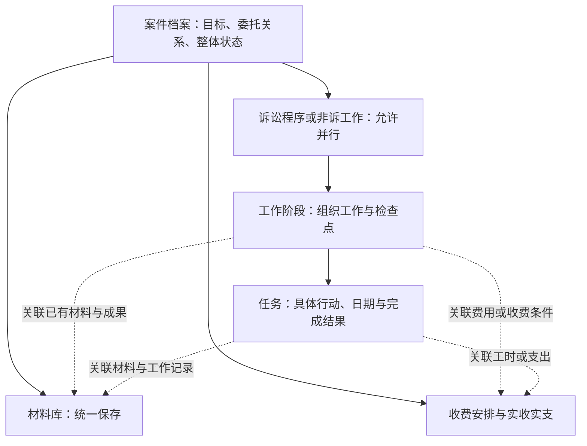

# 案笺：律师工作流调研与产品主线讨论稿

日期：2026-10-18，北京时间。对照版本：案笺 1.3.2。

后续状态：用户已确认采用工作空间方向，1.4 实施规格见[案件工作空间](../design/case-workspace.md)。以下保留当时的研究与建议，来源结论和候选功能不等于全部已实现。

研究原始状态：研究与建议，尚未确认的产品方案。本轮不修改应用、不迁移数据、不发布新版本。本文不替代现行需求和已实现规则；后续需要结合律师实际工作走查再形成正式规格。

## 1. 先回答产品要帮助律师什么

建议的产品定义：**案笺帮助独立律师把一项委托变成可跟进的工作，随时知道下一步、期限、所需材料、已有成果和费用情况，并减少重复记录。**

这是本次研究提出的定位。继续保留已确认的本地优先、离线使用、个人律师、诉讼与非诉兼容的边界。大型律所的审批、人事、团队绩效、获客及自动支付不作为当前主线。

每个案件应当能回答五个实际问题：

1. 我们为谁处理什么问题，目标和委托范围是什么？
2. 正在推进哪些工作，哪些在等待客户、法院或其他对象？
3. 下一步具体做什么、何时做，有哪些明确填写的期限？
4. 所需材料在哪里，哪些成果已经形成、提交或交付？
5. 约定如何收费、哪些款项已到期、实际收支及垫付报销如何？

“建了几个阶段”“图上点到了哪里”不能替代这些答案。软件需要减少律师在日历、文件夹、笔记和账本之间自行拼接信息的负担。

## 2. 调研方法与可信度

查阅六款产品的官方帮助文档、官方功能说明，重点追踪案件 → 阶段 → 任务 → 材料/日期/工时的关系，而非比较首页截图或功能数量。具体链接随结论给出。

- Clio、MyCase、Filevine、Smokeball：有操作级帮助文档，可核对触发条件、任务与日期、相关数据入口。
- Alpha、法蝉：本次以官方产品说明为主，可确认定位和公开功能；没有登录付费工作区，不将宣传页面视为具体交互、数据结构或用户体验的实测证据。
- 未进行厂商演示、付费试用或律师访谈；无法据此证明哪款更易用、哪套工作方式适合所有国内律师。国外支付、期限计算和审批机制不能直接照搬。
- iCourt 标签页中的旧文章不作为当前操作界面的证据；主要依据可直接访问的官方产品与方案页。

下文区分“来源事实”“现状核查”和“我们的建议”。建议不是厂商共同标准，也不是已实现功能。

## 3. 同类产品的工作组织方式

| 产品 | 本次查证到的事实 | 对案笺的启发与限制 |
| --- | --- | --- |
| Clio | 案件仪表板聚合案件资料、财务、联系人与活动；阶段可触发任务清单和文书生成。[仪表板](https://help.clio.com/hc/en-us/articles/16681289917595-Matter-s-Dashboard)、[自动工作流](https://help.clio.com/hc/en-us/articles/35132279298843-Clio-Manage-Automated-Workflows) | 案件是共同上下文，进度变化能连接实际工作；无需让所有页面都重复画阶段图。自动化需要先有任务和模板。 |
| MyCase | 工作流模板可加入任务、日历事件及文书模板；任务内创建的工时会回到同一案件。[工作流](https://supportcenter.mycase.com/en/articles/9370081-creating-and-applying-workflows)、[任务内记工时](https://supportcenter.mycase.com/en/articles/9370073-creating-a-new-task) | 在工作发生处记录，再供案件与财务查看；比事后到多个模块补录更连贯。 |
| Filevine | Phase 表示项目阶段，可回到前一阶段；Taskflow 是由阶段或按钮触发的任务序列，任务可带计时信息。[阶段](https://support.filevine.com/hc/en-us/articles/360004140772-Phases)、[Taskflow](https://support.filevine.com/hc/en-us/articles/360005080892-Taskflow) | 阶段、任务和触发规则各有职责。它的阶段重入会重建相关自动任务，案笺不能未经确认照搬这种重复生成行为。 |
| Smokeball | Workflow 由任务组成，可关联文书；Next Step 可选择已有任务，或新建下一步任务。[Workflow](https://support.smokeball.com/hc/en-us/articles/5737097573655-Create-and-apply-a-Workflow)、[Next Step](https://support.smokeball.com/hc/en-us/articles/6013138616727-Next-Step) | “下一步做什么”是可操作的任务，不是一个抽象阶段名；适合借鉴到个人律师的案件首页。 |
| Alpha | 官方方案强调在项目中明确任务要求、时间节点与相关文档；产品说明列出任务、文档、计时和日程。[律所方案](https://www.icourt.cc/solution/law)、[产品说明](https://www.icourt.cc/product/alpha) | 国内业务也需要围绕工作组织资料；其团队、OA、知识和检索平台范围明显大于案笺，不能整体复制。 |
| 法蝉 | 官方说明将计时贯穿项目，提供卷宗整理与可嵌入案件的知识模板。[官方功能](https://www.fachans.com/) | 工作经验需要落到可复用内容与成果，而非只复制几个阶段名称；公开说明不足以确认其阶段级费用操作。 |

### 3.1 可借鉴的三个模式

**案件聚合。** 案件把人、工作、资料、日期和费用连在一起，方便从不同入口找到同一事实。[Clio 案件仪表板](https://help.clio.com/hc/en-us/articles/16681289917595-Matter-s-Dashboard)提供了明确的实例。

**阶段组织工作，任务承接行动。** 阶段用于观察进度，任务明确行动和日期，工作流用规则或模板帮助复用它们。[MyCase 工作流概述](https://supportcenter.mycase.com/en/articles/9370082-workflow-overview)、[Smokeball Workflow](https://support.smokeball.com/hc/en-us/articles/5737097573655-Create-and-apply-a-Workflow)是直接依据。

**从行动关联业务记录。** 从任务或活动创建工时，相关内容回到案件中。[MyCase 任务工时](https://supportcenter.mycase.com/en/articles/9370073-creating-a-new-task)、[Filevine 活动工时](https://support.filevine.com/hc/en-us/articles/4407522819099-Activity-Based-Time-Entry)说明了这种关系。工时记录不是已经收到的款项；后者仍需要单独的费用和收付款模型。

以上是本次样本中可观察到的模式，不据此断言所有产品都采用相同结构。

### 3.2 不照搬的内容

不默认导入庞大模板、强制顺序闯关、开启复杂触发器、引入团队审批或自动扣款。Filevine 的阶段回退和 Clio 的重复自动化说明都提示：自动生成工作需要处理重复和历史，而不是简单在“切换阶段”时插入新记录。[Filevine 阶段](https://support.filevine.com/hc/en-us/articles/360004140772-Phases)、[Clio 自动化](https://help.clio.com/hc/en-us/articles/35132279298843-Clio-Manage-Automated-Workflows)。

## 4. 案笺目前的断层

以下依据本地源码核查，不是对截图的推测。

| 页面 | 当前办理路径的行为 | 实际内容范围 | 为什么容易误解 |
| --- | --- | --- | --- |
| 概览 | 完整关系图，随后又显示当前关注摘要 | 有关注流程的信息，也有全案待办、日程和工作记录 | 图、摘要和列表并没有统一的作用范围 |
| 材料 | 没有路径图，另设归档范围按钮 | `Materials` 维护自己的范围，默认案件共用 | 和其他页面使用不同的选择状态 |
| 流程详情 | 紧凑节点，可展开图 | 正在浏览的流程，可能不同于当前关注流程 | 浏览、关注与进度状态同时出现，需要用户学习区别 |
| 收支 | 紧凑节点，可展开图；点击节点进入流程详情 | 汇总按整个案件计算，记账时才可另外选流程 | 图看起来像费用筛选器，实际却是跳页入口 |

证据：[CasePage](../../src/features/cases/CasePage.tsx) 的 `viewProgram` 会切换到 `info`；[Finance](../../src/features/finance/Finance.tsx) 的账目首先按 `caseId` 过滤，不接收正在浏览的流程；[Materials](../../src/features/materials/Materials.tsx) 自行维护 `scope`。

模型上的问题更关键：

- [Task 与 CalendarEvent](../../src/domain/types.ts) 没有流程/阶段归属，无法形成“这个阶段接下来要做的事”。工作记录也主要属于案件。
- 材料和账目虽有流程归属，但没有正式阶段关联。阶段文件夹只是用户命名的文件夹，不是模型中的阶段。
- `WorkflowTemplate` 只有名称、类别和阶段名称，不包含实际任务、所需材料、交付物或费用节点。它目前更接近结构模板。
- [Stages](../../src/features/cases/Stages.tsx) 管理阶段状态和历史，并不把阶段变成包含任务、材料和费用的工作空间。
- `parentId` 表示流程承接关系，适合说明来源，不等于具体任务的先后依赖，更不是每日操作主线。
- 费用只有约定总额与实收实支，尚无独立收费计划/到期节点。未填写约定与明确约定 0 元目前也难以区分，不能据此可靠表达“到期待收”。

此前为了减轻材料页和其他页面的视觉占用，分别移除、收起路径，但没有先统一语义。这是局部页面修补，缺少产品体系；继续统一颜色或强行让四页都画同一张图，都不能解决上述断层。

## 5. 三种产品路线的取舍

| 路线 | 如何使用 | 收益 | 主要问题 |
| --- | --- | --- | --- |
| 档案与账本 | 建案后分别管理文件、日历、笔记和账目，阶段只作标签 | 简单，录入少 | 律师仍要自己拼出下一步；无法满足阶段内连续办理 |
| 强制流程引擎 | 按预设节点依次推进，节点决定后续操作和收费 | 标准化程度高 | 诉讼变化、并行工作、补办、重开会不断成为例外，配置成本高 |
| 案件工作空间，阶段组织行动 | 从案件目标进入阶段与任务，就地处理资料、日期和相关费用；全案视图随时查看 | 兼顾连续办理与快速检索 | 需要先统一关联和数据范围，不能只改页面名称 |

**建议采用第三种。** 这属于我们的产品判断。阶段可以提供工作清单和检查点，律师保留决定权；先把工作关联起来，再考虑可选自动化。

## 6. 建议重新明确的概念

保留已经确认的“同一委托或争议共用档案，内部允许并行办理”。同一个档案不应被强行等同于只有一份委托合同或一个收费安排。

| 概念 | 它回答什么 | 示例和边界 |
| --- | --- | --- |
| 案件档案 | 为谁、解决什么问题、整体服务范围是什么 | 同一争议中的相关资料与历史；整体管理状态独立 |
| 诉讼程序或非诉工作 | 本案有哪些可分别办理的部分 | 一审、二审、执行、保全专项、合同审查；此行是概念说明，最终产品统称待走查，不再随意造新术语 |
| 工作阶段 | 这部分工作如何组织 | 材料准备、立案、举证、庭审；可自定义、跳过、重开；不是法定进度的自动判定 |
| 任务 | 下一步具体要完成什么 | 整理证据目录、向客户确认事实、提交某份材料；有明确结果与可选日期 |
| 日程/期限 | 哪个时点需要行动或提醒 | 已确认会议、已填写的提交期限；任务截止日期也可在日历投影，避免再次建一份任务 |
| 材料与成果 | 依据、过程和交付物是什么 | 原始证据、草稿、定稿、回执、录音；身份不由文件夹名字自动推测 |
| 收费安排与财务记录 | 应收、何时应收、实际收到/支出多少 | 收费节点、实收、垫付与报销分开；工时是另一种工作记录 |

图示是建议关系，不是所有字段都必填：简单案件仍可只建档、存材料、记一笔或添加任务；业务结构和阶段按需采用。材料与财务归属于案件，不因阶段调整而消失。

“看的是谁”“重点关注谁”“工作进展如何”也必须分开。重点关注只用于快捷定位和摘要，不能暗中决定材料归属、费用范围或其他工作的完成状态；页面选中效果已经表达浏览位置，无需反复加“查看中”徽标。

## 7. 办理路径应承担什么职责

建议把目前名为“办理路径”的概念拆清楚：

- **业务关系**：解释一审、二审、执行及专项之间的承接或并行关系。只有多个相关业务时才值得画图，放在“办理”中按需查看；一个一审不需要用关系图占据案件首页。
- **工作阶段**：组织正在开展的工作。选中“举证”后，应直接看到任务、日期、材料与成果、相关费用入口。
- **工作指引**：可选模板提供任务和材料清单，减少遗漏。模板应可删减、可不用，不把律师强制锁在固定路线中。

因此软件可以辅助律师计划、执行和回顾，但不通过点击一串节点替代实际办理，也不自动判断法院程序和收费权利。Git 的分支比喻仅能辅助解释并行和来源，不能直接拿提交、合并和线性历史建模律师工作。

已经发生的沟通、提交、交付与变更另入办理记录；关系图不充当历史时间轴。“业务怎样关联”“发生过什么”和“下一步做什么”分别呈现。

### 7.1 每个阶段应该支持的工作

| 阶段内内容 | 可执行操作 | 与其他视图的配合 |
| --- | --- | --- |
| 待做与等待事项 | 添加任务、明确等待对象、填日期、记录完成结果 | 今日工作与案件概览读取同一任务 |
| 日程与期限 | 创建安排，或关联已有日程 | 日历修改后回写同一记录 |
| 材料与成果 | 上传、关联已有材料、标记实际交付/提交结果 | 材料页可按阶段查看同一文件 |
| 工作记录/工时 | 记录沟通、处理过程；按需记时 | 可用于回顾与服务报告；不自动变成实收 |
| 费用 | 记支出、上传凭据、查看相关收费条件 | 费用页汇总同一记录，不新增另一笔 |

阶段被选中不意味着工作已完成。阶段完成、重新打开和删除都不应复制材料、倒扣已收款或自动重复产生收费节点。未完成事项需要明确保留、取消或改归属，不能跟着图中一个点消失。

## 8. 四类页面怎样协作

先确定职责，页面名称和数量仍可调整；以下四类用于讨论，不是要求保留现有四个 Tab。

| 视图 | 首要问题 | 应放什么 | 不承担什么 |
| --- | --- | --- | --- |
| 案件概况 | 全案发生了什么、下一步是什么 | 委托目标、代理身份、并行工作摘要、明确的下一步/待确认/期限、收费摘要 | 不重复大图、完整材料目录和所有操作历史 |
| 办理 | 我现在怎样把工作做下去 | 具体业务与阶段、任务、相关材料/日期/费用；业务关系图按需展开 | 不成为只能向前点击的静态表单 |
| 材料 | 找到哪份资料或成果 | 全案材料库，业务/阶段/文件夹筛选，来源与关联位置 | 不创建另一份阶段材料副本 |
| 费用 | 应收与实收、成本与报销分别如何 | 收费安排、节点、实际收支、凭据和可选工时 | 不靠一个阶段选择器暗示不存在的费用筛选 |

### 8.1 范围与跳转规则

建议案件始终是共同上下文，各资源页默认查看全案。**统一不等于四页都放同一张图，而是进入和离开一个上下文时，范围与行为始终明确。**

1. “办理”内部选择一审/举证，保留此处浏览位置；不悄悄把整个案件或其他页面的内容变成该阶段。
2. 在阶段中点击“查看全部材料/费用”，打开对应资源视图，并显式显示可清除的“一审 · 举证”筛选。
3. 普通进入材料或费用页时，若保留了该页筛选，必须继续显示；不得留一个不可见的历史筛选，也不因为浏览了别的流程就静默替换筛选。
4. 从资源记录可回到所属工作；返回后保持原来位置。案件共用、未归属阶段的项目有明确位置。
5. 同一资源视图中的数量、图表、合计与列表使用相同筛选条件。整案收费约定若另作展示，必须明确标成整案，不与阶段合计混淆。
6. 去掉材料/费用页上只负责跳到流程详情的路径图。筛选控件负责筛选，导航入口负责跳转，两者不再共用同一个视觉组件。

没有采用“全局永远选中一个阶段，四页全部跟着变”的方案：它会使全案共用资料、跨阶段工作和整体收款容易被隐藏。阶段内提供连续工作入口，全案视图提供检索和汇总，两者通过明确关联配合。

## 9. 材料、计费与收款的关键建模

### 9.1 材料：一份保存，多处引用

同一份证据可以用于一审举证、保全和二审；不因为在不同阶段使用而复制三份文件。建议区分材料的存储位置与使用关联，阶段或任务引用文件，材料页能反查用途。文件夹负责用户整理，不能代替正式业务关联。

阶段删除时，解除或调整阶段关联，材料仍在案件材料库。暂未指定阶段不算录入失败，也不能根据当前浏览阶段自动猜测历史文件归属。

### 9.2 费用：阶段可以关联，收费规则由约定决定

“每个阶段支持计费”值得支持，但要拆成三件事：

| 记录 | 业务含义 | 与阶段的关系 |
| --- | --- | --- |
| 工作量/工时 | 做了多少工作，可计费或不计费 | 可关联任务和阶段，不代表已收款 |
| 收费安排/收款节点 | 约定金额、条件、到期与未到期部分 | 可以按整案、某程序或明确条件约定；不要求每阶段都收费 |
| 实收实支/报销 | 实际发生的资金记录及凭据 | 可注明相关业务和阶段，整案汇总只计一次 |

固定费、分期、按程序分别约定和计时收费需要能区分。当前已有的是简单账本，不应因为账目有 `proceedingId` 就声称支持上述收费模型。

假设某示例约定共 30,000 元，签约时 12,000 元，另 18,000 元在用户明确约定的条件满足后支付：实际收到 12,000 元，剩余 18,000 元未收；若第二节点尚未到期，“到期待收”不能直接显示成 18,000 元。该示例只说明产品数据语义，不提供收费或法律规则。

阶段完成最多提示用户核对已设收费条件，不能自动记成收到钱；阶段重开不能再次生成同一收费节点。未填写收费约定应显示未填写，不能默认为明确约定 0 元。旧数据里的 0 也不能擅自改判为真实零收费或某个应收金额。

### 9.3 统一数据源，而非同步四套记录

任务、日程、文件、工作记录、费用分别是独立事实；阶段和案件提供组织与关联。跨页面投影同一 ID 的记录，不复制一份“阶段任务”和一份“首页任务”。有截止日期的任务可以直接投影进日历，具体会议仍是日程；二者有关联也不因此重复发出同一次提醒。

## 10. 用完整工作场景检验建议

### 场景 A：民商事案件，一审与保全并行

建立案件，记录委托目标与我方身份；明确新增一审，按需选择工作模板。保全作为可独立跟进的工作并行开展，不伪装成必须等一审结束才开始的后续节点。

律师在举证阶段建立“整理并提交补充证据”任务，关联已有合同和转账记录，填写需要核对的日期。任务在首页出现；从日历调整日期后，阶段内仍显示同一任务。完成工作时关联提交稿或回执，保存工作记录。

为该工作记一笔带凭据的支出，阶段中能看到，费用页能找到同一笔；无论从哪个入口编辑，都不会重复计入全案。保全使用同一份合同材料，引用它而不是重新归档复制。

### 场景 B：合同审查等非诉工作

建立档案后可直接添加工作和资料。需要模板时再明确采用“资料确认 → 审查修改 → 反馈交付”等工作组织方式；不自动生成一审，不要求填写法院法官，也不要求把客户叫原告。阶段中的成果是审查稿、问题清单和交付记录。

### 场景 C：中途变化与结案

阶段完成后可补办或重开；修改状态保留历史，不撤回已提交的材料或已收到的款项。整案管理状态、某一程序是否办结、任务是否完成和费用是否结清分别记录。办结后仍能查看或补充财务/归档记录；是否重新开展业务要明确操作。

### 应通过的验收问题

1. 打开一个月没处理的案件，能否快速说清委托目标、当前工作、下一步、明确期限和等待对象？
2. 从阶段创建任务，是否无需再到首页重复录入？
3. 材料多处使用时，能否找到同一份原始归档与全部使用位置？
4. 从阶段上传费用凭据，能否在费用页核对同一金额与记录？
5. 在任何页面能否看出是全案还是某业务/阶段的范围？
6. 跳过、重开、删除阶段后，材料、账目、日期和未办事项是否仍可解释、可追溯？
7. 不采用模板、没有建立流程的简单案件，是否仍然可用？

不再以“页面字段齐全”“节点可以切换”“测试条数多”作为产品主线成立的替代证明。

## 11. 后续设计顺序与待验证内容

建议下一步先讨论产品主线和一条完整工作样例，再做低保真交互，不直接开始大规模改代码。

1. 以“下一个具体行动、明确期限、相关资料和费用”检验产品定位。
2. 用一审与并行专项、非诉工作各走一遍，确认对象边界及用语。业务结构的统称待实际走查确定，不再反复换词掩盖逻辑。
3. 将一个阶段内的任务 → 材料 → 日历 → 费用贯通，确认何处输入、何处查看、怎样返回及去重。
4. 再决定导航层级、默认页和路径图位置，制作可走查的轻量原型。
5. 确认后再规划数据迁移；最后才打磨字体、颜色和图标。

需要律师经验补充的重点是：实际工作中“等待外部”怎样跟进；收费按委托、程序还是条件分别约定；常规办案是否愿意采用简短可编辑的任务清单。研究建议默认轻量辅助、模板可选、收费按明确约定记录，但不能把假设当作已确认需求。

迁移需要保留现有材料 ID、文件、流程、阶段、身份和账目。旧任务和日程没有阶段归属时继续保留为案件级记录；不根据标题、日期、文件夹名或当前关注猜测归属。旧账本不自动变成计费单或分期计划。自动化以后按明确启用、可预览、防重复、可追溯的规则逐项增加。

## 12. 本轮产出与现有文档关系

本轮完成官方资料研究、现状核查与候选产品模型，未修改应用代码、版本、数据库或现有案件。本稿中的阶段工作空间、收费节点与资源关联等均为建议，尚未实现。

现行模型见[案件档案与办理流程](../case-model.md)，既有目标见[第一版需求](../requirements.md)。研究揭示了它们与当前页面之间的脱节；不能通过改写现状文档把未完成的产品逻辑表述成已经落地。
